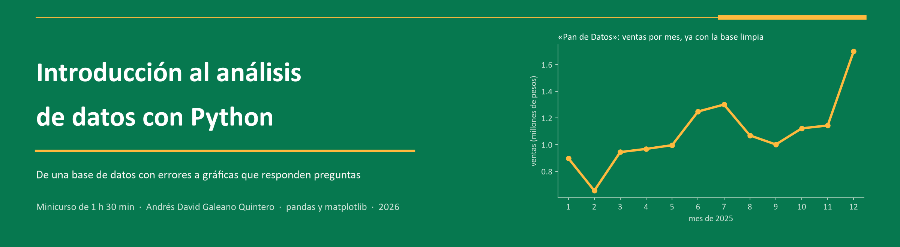
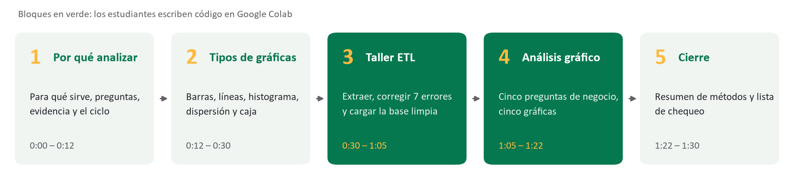
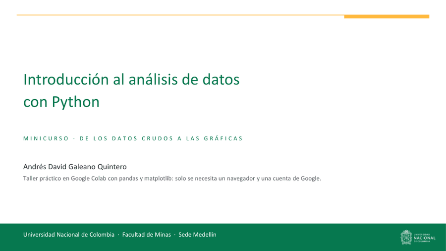
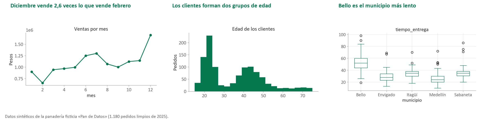

<p align="center">
  
</p>

<p align="center">
  
  
  
  
  
</p>

<p align="center">
  <b>Todo lo que vamos a usar en clase, en un solo lugar</b><br>
  <a href="#1-la-presentación-por-qué-analizar-datos-y-cómo-leer-una-gráfica">Presentación</a> &nbsp;·&nbsp;
  <a href="#2-el-taller-de-la-base-sucia-a-la-base-limpia">Taller</a> &nbsp;·&nbsp;
  <a href="#3-para-seguir-practicando">Para seguir practicando</a> &nbsp;·&nbsp;
  <a href="#cómo-empezar">Cómo empezar</a>
</p>

Hola, soy Andrés. Este es el material del minicurso de análisis de datos que vamos a hacer
juntos en hora y media.

Te cuento algo que casi nadie dice al principio: ninguna base de datos llega lista para
analizar. Siempre trae algo raro: filas repetidas, el mismo nombre escrito de diez maneras,
números guardados como texto, fechas que en realidad no son fechas, celdas vacías y valores
que no tienen sentido. Si graficas así, la gráfica sale bonita, pero la conclusión sale mal.

Por eso la clase tiene dos partes. Primero hablamos de **para qué y por qué analizar datos** y
de **qué gráfica usar para cada pregunta y cómo leerla**. Después abrimos una base llena de
errores y la limpiamos **juntos, paso a paso**, hasta que esté lista para graficar.

La base es de **«Pan de Datos»**, una panadería que me inventé para el curso, con domicilios
en el Valle de Aburrá: 1.250 pedidos de 2025 con siete tipos de error que metí a propósito.
Tú vas a trabajar en **Google Colab**, así que no tienes que instalar nada. En cada paso te
muestro en la diapositiva qué método escribir. Y tranquilo con el código: es **lo más simple
posible**, sin funciones, sin bucles y con una a tres líneas por celda.

<p align="center">
  
</p>

| | Qué vamos a hacer | Dónde está | Qué haces tú |
|:-:|---|---|---|
| **1** | [Entender por qué analizar y cómo leer gráficas](presentacion) | [Presentación (PDF)](presentacion/Minicurso_Analisis_de_Datos.pdf) · [PowerPoint](presentacion/Minicurso_Analisis_de_Datos.pptx) · 38 diapositivas | escuchar, preguntar y opinar |
| **2** | [Limpiar la base y graficarla](notebooks) | [Tu notebook](notebooks/taller_estudiante.ipynb) · [la solución](notebooks/taller_solucion.ipynb) · [los datos](datos) | corregir 7 errores y hacer 5 gráficas |
| **3** | [Seguir practicando en casa](ejercicios) | [8 ejercicios](ejercicios/README.md#ejercicios) | [un proyecto con datos reales](ejercicios/README.md#proyectos-con-datos-reales) |

---

## 1. La presentación: por qué analizar datos y cómo leer una gráfica

<p align="center">
  <a href=".github/readme/presentacion_portada.png">
    
  </a>
</p>
<p align="center"><sub>Un vistazo a algunas diapositivas de la clase.</sub></p>

La **[presentación](presentacion/Minicurso_Analisis_de_Datos.pdf)** acompaña toda la clase.
Así nos vamos a repartir los 90 minutos:

1. **¿Por qué y para qué?** (0:00–0:12). Analizar datos es responder preguntas con evidencia. Te muestro casos en los que leer bien los datos cambió decisiones reales: John Snow y el cólera, Florence Nightingale en los hospitales, *Moneyball* en el béisbol y la calidad del aire aquí en el Valle de Aburrá. También vemos por qué «basura entra, basura sale» y el ciclo que siempre se repite: pregunta → extraer → transformar → cargar → analizar → comunicar.
2. **Tipos de gráficas** (0:12–0:30). Cada gráfica responde una pregunta distinta. Vemos barras, líneas, histograma, dispersión y caja y bigotes, cómo se lee cada una y en qué se equivoca la gente. También te enseño a desconfiar de las gráficas que engañan.
3. **Taller ETL** (0:30–1:05). Aquí te toca a ti: abrimos el archivo, corregimos los siete errores y guardamos la base limpia.
4. **Análisis gráfico** (1:05–1:22). Con la base limpia, le hacemos cinco preguntas al negocio y las respondemos con cinco gráficas.
5. **Cierre** (1:22–1:30). Repasamos los métodos que usamos y te llevas una lista de chequeo para limpiar cualquier base.

## 2. El taller: de la base sucia a la base limpia

En cada paso hacemos siempre lo mismo: primero **miramos** qué está mal, luego lo
**corregimos** y al final **comprobamos** que quedó bien. En tu notebook el método clave
aparece como `___`, y en la diapositiva te muestro cuál va ahí.

| Paso | Qué está mal | Cómo lo vemos | Cómo lo arreglamos |
|:-:|---|---|---|
| **E** | El archivo usa `;` y coma decimal, y si lo lees sin más, todo cae en una sola columna | `df.head()`, `df.shape` | `pd.read_csv(..., sep=';', decimal=',')` |
| **1** | Los nombres de las columnas traen espacios y mayúsculas (`' Fecha'`, `'Municipio '`) | `df.columns` | `.str.strip().str.lower().str.replace(' ', '_')` |
| **2** | 40 pedidos quedaron registrados dos veces | `df.duplicated().sum()` | `df.drop_duplicates()` |
| **3** | Hay 19 formas de escribir 5 municipios y 14 de escribir 4 métodos de pago | `value_counts()` | `.str.strip().str.title()` y `.replace({...})` |
| **4** | Los precios son texto: `$2.800` | `df.dtypes` | `.str.replace('$', '')`, `.str.replace('.', '')`, `pd.to_numeric()` |
| **5** | Las fechas también son texto: `03/01/2025` | `df.dtypes` | `pd.to_datetime(..., format='%d/%m/%Y')`, `.dt.month` |
| **6** | Faltan datos en el pago (36), el precio (12) y la edad (60) | `df.isna().sum()` | `fillna('Sin dato')`, `dropna(subset=[...])` |
| **7** | Hay entregas de −15, 0 y 999 minutos y calificaciones de 0, 10 y 45 (18 filas) | `df.describe()` | `between(1, 180)`, `between(1, 5)` |
| **L** | La base limpia solo existe en la memoria de Colab | `df.info()` | `df.to_csv('domicilios_limpio.csv', index=False)` |

Al final te quedan **1.180 pedidos y 13 columnas**, y con eso respondemos cinco preguntas:
¿qué productos se piden más?, ¿cómo cambian las ventas en el año?, ¿quiénes son los clientes?,
¿tardamos más cuando el pedido va más lejos? y ¿dónde se demoran más los domicilios?

| Notebook | Para qué es | Ábrelo aquí |
|---|---|---|
| [`taller_estudiante.ipynb`](notebooks/taller_estudiante.ipynb) | el tuyo, con 45 huecos `___` para llenar en clase | [](https://colab.research.google.com/github/makecontrol-ing/minicurso-analisis-de-datos/blob/main/notebooks/taller_estudiante.ipynb) |
| [`taller_solucion.ipynb`](notebooks/taller_solucion.ipynb) | la versión completa, para que revises en casa | [](https://colab.research.google.com/github/makecontrol-ing/minicurso-analisis-de-datos/blob/main/notebooks/taller_solucion.ipynb) |

Antes de empezar, sube [`datos/domicilios_sucio.csv`](datos/domicilios_sucio.csv) a Colab. Y si
en algún momento te atrasas o Colab se reinicia, no te preocupes: al comienzo de las gráficas
hay un **punto de control** que carga [`datos/domicilios_limpio.csv`](datos/domicilios_limpio.csv)
para que sigas con nosotros.

## 3. Para seguir practicando

Si te quedaste con ganas, en [ejercicios](ejercicios/README.md) te dejé más preguntas para
la misma base: qué municipio vende más, qué día se piden más domicilios, con qué método de
pago se gasta más por pedido. También hay ejercicios para cambiar las decisiones de limpieza y
ver qué pasa. Y si quieres un reto de verdad, te propongo repetir todo con datos públicos reales
de Colombia.

<p align="center">
  
</p>

---

## Qué hay en cada carpeta

```text
.
├── presentacion/
│   ├── Minicurso_Analisis_de_Datos.pptx   la presentación, con mis notas de cada diapositiva
│   └── Minicurso_Analisis_de_Datos.pdf    la misma presentación en PDF
├── notebooks/
│   ├── taller_estudiante.ipynb            el tuyo, con huecos para llenar
│   ├── taller_solucion.ipynb              la solución, ya ejecutada
│   └── requirements.txt
├── datos/
│   ├── domicilios_sucio.csv               1.250 pedidos con 7 tipos de error
│   └── domicilios_limpio.csv              1.180 pedidos ya limpios (punto de control)
├── ejercicios/
│   └── README.md                          ejercicios y proyectos para seguir practicando
├── fuentes/                               cómo armé todo esto (datos, notebooks, presentación)
└── .github/readme/                        las imágenes de esta página
```

## Cómo empezar

**Si solo quieres ver la presentación,** abre [`presentacion/Minicurso_Analisis_de_Datos.pdf`](presentacion/Minicurso_Analisis_de_Datos.pdf).

**Para hacer el taller en Google Colab** (lo que vamos a usar en clase):

1. Abre [tu notebook en Colab](https://colab.research.google.com/github/makecontrol-ing/minicurso-analisis-de-datos/blob/main/notebooks/taller_estudiante.ipynb).
2. Descarga [`domicilios_sucio.csv`](datos/domicilios_sucio.csv) y arrástralo al ícono de carpeta que está a la izquierda en Colab.
3. Ejecuta cada celda con **Shift + Enter**. Cuando veas `___`, escribe el método que te muestro en la diapositiva.

**Si prefieres trabajar en tu computador** (Python 3.9 o más reciente):

```sh
python -m pip install -r notebooks/requirements.txt
cd notebooks
cp ../datos/domicilios_sucio.csv .
python -m jupyter lab taller_estudiante.ipynb
```

**Y si te da curiosidad cómo armé el curso,** en [`fuentes/`](fuentes) están los scripts que
generan la base de datos, los notebooks, las figuras y la presentación. Para regenerar todo,
desde la raíz y después de `pip install -r fuentes/requirements.txt`:

```sh
python fuentes/generar_datos.py                     # crea la base sucia
python fuentes/verificar_limpieza.py                # revisa que la limpieza dé lo que debe dar
python fuentes/construir_notebooks.py --ejecutar    # arma los notebooks y la base limpia
python fuentes/figuras_teoria.py
python fuentes/figuras_taller.py
python fuentes/construir_presentacion.py            # arma el PowerPoint
powershell -ExecutionPolicy Bypass -File fuentes/exportar.ps1   # lo pasa a PDF (necesita PowerPoint)
```

Las imágenes de esta página salen de `python .github/readme/generador/generar_todo.py`.

## Para seguir aprendiendo

Estos son los sitios que te recomiendo cuando quieras ir más allá:

- La documentación de pandas: [pandas.pydata.org/docs](https://pandas.pydata.org/docs/)
- Kaggle Learn, con cursos gratis de pandas, limpieza y visualización: [kaggle.com/learn](https://www.kaggle.com/learn)
- Google Colab: [colab.research.google.com](https://colab.research.google.com)
- Datos abiertos de Colombia para practicar: [datos.gov.co](https://www.datos.gov.co)

Una aclaración: «Pan de Datos» no existe. Todos los datos son **inventados** para el curso, así
que ninguna cifra corresponde a una empresa real.

## Sobre mí

Soy **Andrés David Galeano Quintero**, estudiante de la Universidad Nacional de Colombia,
Facultad de Minas, Sede Medellín. Si algo no te funciona o tienes una idea para mejorar el
curso, abre un *issue* en este repositorio.
